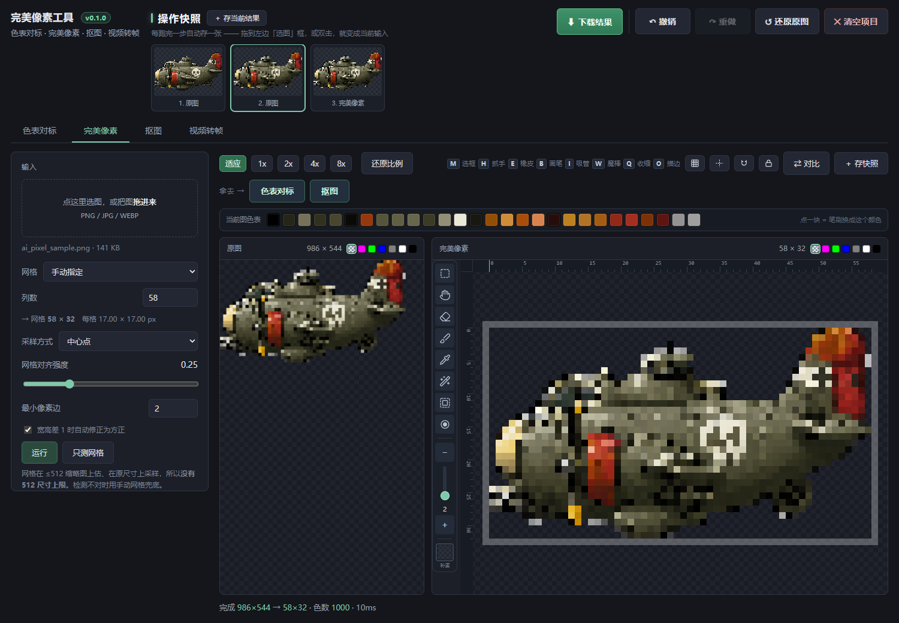
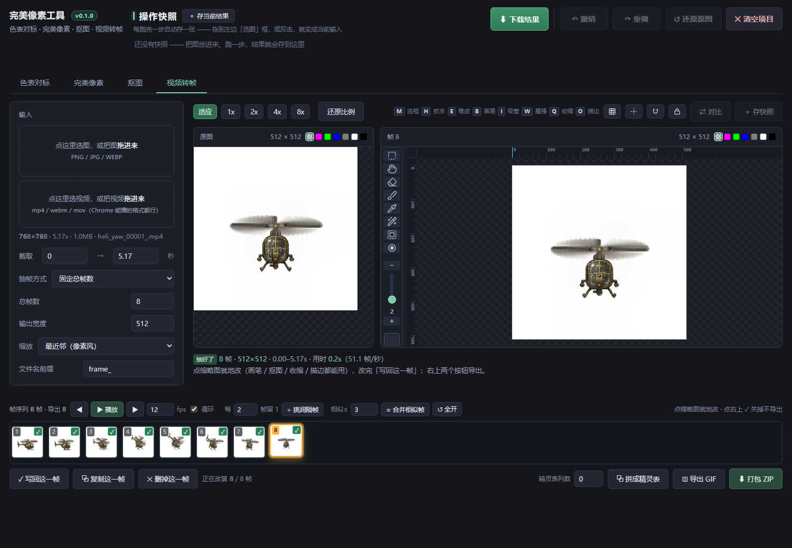
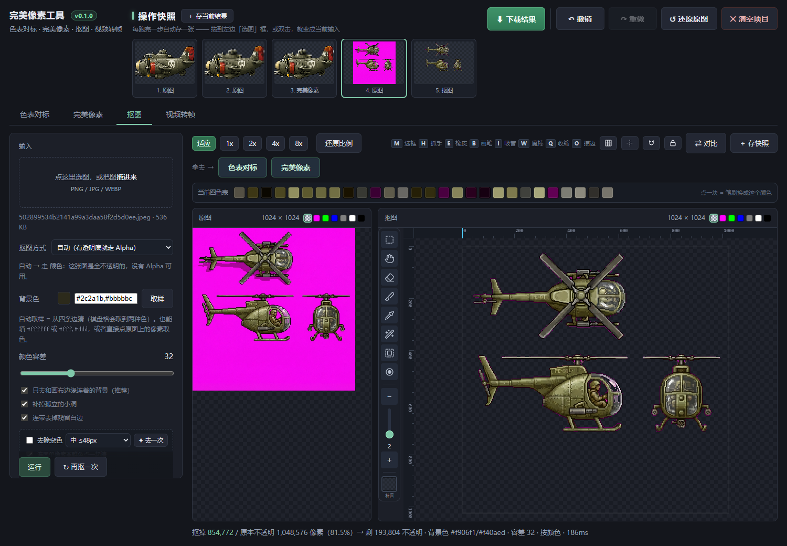

# 完美像素工具 · Perfect Pixel Tool

**v0.1.1** · 单文件 · 离线 · 零依赖


一个为「AI 生成图 / 视频 → 2D 游戏可用素材」这条流水线准备的像素处理工具。双击一个 HTML 文件就能用，不装环境、不联网、不上传，所有处理都在浏览器本地完成。



---

## 它解决什么

AI 出的图直接进游戏是用不了的：颜色有几千种、边缘是糊的、背景抠不干净、要做成动画还得一帧一帧拆。

四件事，四个页签，从左往右排：

| 页签 | 干什么 |
|---|---|
| **色表对标** | 上传一张参考像素画当模板，把 AI 图的上千种颜色压到模板那一套配色上 |
| **完美像素** | 把「看着像像素」的模糊放大图还原成真正的 1x 像素图 |
| **抠图** | 洋红 / 绿幕 / 纯色背景抠除，配削边、描边、画笔、魔棒、选框 |
| **视频转帧** | 抽帧、逐帧编辑、挑帧、拼精灵表、导出 GIF / ZIP / Godot 场景 |

四步可以串起来跑：拼好的精灵表点一下「拿去 →」就送进抠图或完美像素，**不用存文件中转，也不用重新上传**。



---

## 为什么是单文件

- **双击即用** —— 不用装 Python、不用装 ffmpeg、不用开命令行
- **完全离线** —— 零 `fetch`、零 XHR、零外部依赖，图片不出本机
- **可以直接拷给别人** —— 一个 HTML，259 KB

---

## 使用

1. 下载 `完美像素工具.html`
2. 双击，用 **Chrome / Edge** 打开

> 推荐 Chrome 94+ 或 Edge 94+。视频抽帧和 GIF 拆帧依赖浏览器的 `ImageDecoder`，Firefox 和 Safari 上这两块功能不可用，其余功能正常。

### 常用快捷键

| 键 | 作用 | 键 | 作用 |
|---|---|---|---|
| `M` | 选框 | `Q` | 削一圈 |
| `H` | 抓手 | `O` | 描边 |
| `B` | 画笔 | `P` | 播放 / 暂停（视频页） |
| `E` | 橡皮 | `,` `.` | 上一帧 / 下一帧 |
| `I` | 吸管 | `[` `]` | 笔刷大小 |
| `W` | 魔棒 | `Ctrl+Z` / `Ctrl+Y` | 撤销 / 重做 |

---

## 从源码构建

仓库里是分开的源码，构建时把核心算法内联进单文件：

```bash
node _build.js    # pixcore.js + _template.html → 完美像素工具.html
node test.js      # 75 项回归测试
```

| 文件 | 说明 |
|---|---|
| `pixcore.js` | 全部核心算法，纯 JS、无 DOM 依赖，可在 Node 里直接测 |
| `_template.html` | 界面、交互、样式 |
| `_build.js` | 把 `{{CORE}}` 占位替换成 pixcore.js 的内容 |
| `test.js` | 75 项回归：完美像素、色表、抠图、描边、GIF 编码、DOM 引用完整性 |
| `CHANGELOG.md` | 开发记录：逐条改动日志 + 构建说明 |

---

## 功能细节

### 色表对标
- 可以从「另一张像素画」取色，而不只是预设调色板
- Lab 感知色差 / RGB 两种匹配方式
- 「近似色合并」滑块控制容忍度，专门吃 AI 图的噪点色
- 抖动强度可调

### 完美像素
- 自动检测原图的方块宽度和网格尺寸
- 检测失败时可以手动指定列数

### 抠图
- 自动从四边取样背景色，容差默认 32
- Alpha 通道模式（直接按透明度抠）
- 背景孤岛清理：被主体包住的背景色块也能清掉
- 削一圈：纯几何地削掉最外层一圈，不看颜色
- 描边：外描边、不覆盖主体、默认近黑 `#1a1a22`，按住 Shift 内描
- 撤销 / 重做、快照架、标尺、可拖动辅助线

### 视频转帧
- 不走 ffmpeg，用浏览器原生解码（h264 / vp9 / av1）
- 单次 1024² 约 45–49 帧/秒
- 帧显隐（不导出但保留，可随时恢复）与真删除分开
- 挑间隔帧（每 N 帧留 1）、合并相似帧（按平均色差阈值）
- 拼精灵表，列数可指定，超过 4096px 自动折行
- 导出 ZIP 时附带 Godot 4 可用的 `.tres` / `.tscn`

### GIF 双向
- **拆**：GIF 拖进来，拆成帧序列，保留每帧原始延迟
- **合**：帧序列导出 GIF89a，跨帧统一 256 色量化，透明像素占一个调色板索引



---

## 已知限制

| 限制 | 说明 |
|---|---|
| 视频格式 | 只支持浏览器能解的（h264 / vp9 / av1）。HEVC、ProRes 解不了 |
| 完美像素检测 | 块宽 ≤4px 且原图带严重模糊时会检测失败，用手动指定列数 |
| 放大上限 | 按布局尺寸 20000px 卡住，1024 的图最大 ×19.5。再大 Chromium 会不绘制 |
| GIF 编码 | GIF 只有 1 位透明，半透明边缘会被压成不透明或全透明 |
| 色调映射 | 色表对标用的是最近色替换，不是色相映射。模板色少时中间调会被压扁 |

---

## 算法来源与致谢

这个工具是站在别人肩膀上做出来的。**完美像素网格检测**这块不是原创，来源可以一路查到源头：

```
theamusing/perfectPixel  (Python · MIT · © theAmusing)
  FFT 估算网格周期 + Sobel 边缘细化 + 格内采样
        ↓  对照其 perfect_pixel_noCV2.py 用 JavaScript 重写
本项目  pixcore.js 的网格检测与格内采样
```

- **[theamusing/perfectPixel](https://github.com/theamusing/perfectPixel)** — MIT 许可，版权归 theAmusing。算法源头，本项目是对照它的 Python 实现重写的。
- 相关的还有 **[KennethJAllen/proper-pixel-art](https://github.com/KennethJAllen/proper-pixel-art)**（MIT）和 **[spritefusion-pixel-snapper](https://github.com/Hugo-Dz/spritefusion-pixel-snapper)**（MIT），同一条技术脉络上的其它实现。

**其余部分为独立实现**：抠图、削边、描边、杂色清理、色表对标（中位切分是 Heckbert 1982 年的经典算法，自己写的实现）、视频转帧、GIF 编解码、全部界面与交互。

**还有一处是自研的**：`detectGrid` / `detectPitchAxis` 这套「整数块一致性」检测。上游算法用 FFT 估周期，遇到 AI 出图那种「块内纯色、边缘被糊掉 1–2px」的图会估错；这里的做法是按 k 切条看块内颜色散不散，真周期处一定出现低谷。它对糊边不敏感，判不了时才回落到上游的 FFT 方案。

完整声明见 [LICENSE](LICENSE) 末尾的「第三方代码声明」。

---

## 许可

见 [LICENSE](LICENSE)。
